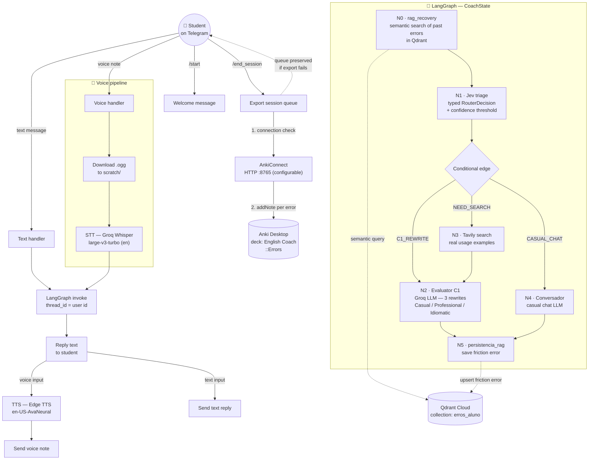

<div align="center">

# 🎓 AI English Coach

**An AI-powered English tutor on Telegram that detects friction errors, coaches students to C1 fluency, remembers their mistakes forever, and turns them into Anki flashcards.**

[](https://www.python.org/)
[](https://www.langchain.com/langgraph)
[](https://groq.com/)
[](https://qdrant.tech/)
[](https://core.telegram.org/bots/api)

</div>

---

## 🚀 1. About the Project

**AI English Coach** is a conversational English tutor delivered through Telegram. Instead of a generic chatbot wrapper, it is built as a **stateful multi-step agent pipeline** (LangGraph) that combines semantic memory, typed decision routing, real-time web evidence, and spaced-repetition export into a single coaching loop.

### The Problem It Solves

Intermediate learners (B2 → C1) don't fail because they don't know grammar rules — they fail because of **friction errors**: literal translations, weak collocations, and register mismatches ("*make a photo*" instead of "*take a photo*"). These errors repeat silently for years because nothing in the learner's routine captures, remembers, and drills them.

### What the Coach Does

| Capability | How It Works |
|---|---|
| 💬 **Text & voice interaction** | Students chat via text or Telegram voice notes; voice is transcribed by Groq Whisper and answered back with natural TTS audio. |
| 🧠 **Permanent error memory (RAG)** | Every friction error is embedded and stored in Qdrant Cloud, then semantically retrieved on future messages and injected into the coaching prompt — *the tutor remembers your old mistakes and stops you from repeating them*. |
| 🎯 **Typed intent triage (Jev Router)** | Each message is classified into `C1_REWRITE`, `NEED_SEARCH`, or `CASUAL_CHAT` through a typed, fail-safe router with a confidence threshold. |
| ✍️ **C1 rewriting in 3 registers** | The evaluator LLM rewrites the student's sentence as **Casual / Professional / Idiomatic**, explaining the improvement. |
| 🌐 **Real-world usage evidence** | When the student asks about meaning/usage, Tavily retrieves authentic examples of how native speakers actually use the expression. |
| 🎴 **Automatic Anki export** | Friction errors accumulate in a per-user session queue and are exported as flashcards to the `English Coach::Errors` deck on `/end_session`. |
| 🔊 **Voice in, voice out** | Groq Whisper (STT) in, Microsoft Edge TTS out — a hands-free speaking practice loop. |

### Design Principles

- **Graceful degradation everywhere**: every external dependency (Tavily, Qdrant, AnkiConnect, Groq) is wrapped in timeouts + `try/except` — a failing service degrades the answer, never the bot.
- **Cost control**: typed triage routes only what needs an LLM rewrite to the LLM; the confidence threshold fails safe to casual chat.
- **Session continuity**: per-user `thread_id` checkpointing (SQLite) preserves conversational state across messages.

---

## 🛠️ 2. Technologies & Architecture

| Technology | Role |
|---|---|
| **Python 3.14** | Core language for the entire pipeline. |
| **LangGraph** | Agent orchestration: typed shared state (`CoachState`), 6 specialized nodes, conditional edges, and SQLite checkpointing per user thread. |
| **Groq API** | LLM inference (`openai/gpt-oss-120b`) for C1 evaluation and casual conversation, plus Whisper `large-v3-turbo` for speech-to-text. |
| **Qdrant Cloud** | Vector database for the student's error memory: semantic search of past friction errors filtered by user. |
| **sentence-transformers** | Local embeddings (`all-MiniLM-L6-v2`, 384 dims) — no per-query embedding API cost. |
| **Tavily API** | Web search for authentic, real-world usage examples of English collocations. |
| **AnkiConnect** | Local HTTP tool endpoint (port `8765`, configurable) that exposes Anki as an MCP-style tool: deck creation and flashcard injection. |
| **Telegram Bot API** (`python-telegram-bot`) | Student-facing interface: command handlers, text and voice message handling. |
| **LangSmith** | Optional LLM tracing and observability for the whole graph, toggled via environment variable. |
| **Pydantic Settings** | Typed, validated configuration loaded from `.env` (`config/settings.py`). |
| **python-dotenv** | Loads environment variables before application bootstrap. |
| **edge-tts** | Neural text-to-speech (`en-US-AvaNeural`) for voice replies. |

### Project Structure

```
ai-english-coach/
├── main.py                        # Entrypoint: loads .env, bootstraps logging, starts the bot
├── requirements.txt               # Pinned dependencies
├── .env.example                   # Configuration template (safe to commit)
├── config/
│   └── settings.py                # Typed settings (pydantic-settings) — single source of truth
├── src/
│   ├── telegram_bot.py            # Telegram handlers: /start, /end_session, text & voice pipelines
│   ├── agent/
│   │   ├── state.py               # CoachState — typed shared state schema
│   │   ├── nodes.py               # Graph nodes: rag_recovery, triage, evaluator, tavily, chat, persistence
│   │   └── graph.py               # Graph assembly, conditional edges, SqliteSaver checkpointer
│   ├── decision/
│   │   └── jev_router.py          # Typed intent router (RouterDecision + confidence threshold)
│   ├── rag/
│   │   ├── embeddings.py          # Lazy-loaded local embedding model
│   │   └── vector_service.py      # Qdrant collection lifecycle, upsert, filtered semantic search
│   ├── services/
│   │   ├── stt.py                 # Groq Whisper transcription (audio → text)
│   │   └── tts.py                 # Edge TTS synthesis (text → audio)
│   └── tools/
│       ├── anki_service.py        # AnkiConnect client: connection check, deck creation, card injection
│       └── tavily_search.py       # Web search with timeout + graceful degradation
├── tests/
│   ├── test_anki.py               # Integration smoke test: AnkiConnect
│   └── test_qdrant.py             # Integration smoke test: Qdrant upsert + semantic search
└── scratch/                       # Local artifacts (SQLite checkpoints, temp audio) — gitignored
    └── mini_graph/                # LangGraph study notebook (minimal working example)
```

---

## 📊 3. Architecture Diagram



<details>
<summary><b>Steady-state flow, step by step</b></summary>

1. **Ingestion** — a text message goes straight to the graph; a voice note is downloaded to `scratch/`, transcribed by Groq Whisper (forced to English), then enters the graph.
2. **Memory recall** — `rag_recovery` performs a semantic search in Qdrant (filtered by user) and injects the student's past friction errors as context.
3. **Typed triage** — the Jev router classifies the intent and returns a pydantic `RouterDecision`; a conditional edge routes to the right specialist. If confidence is below the configured threshold, the router fails safe to `CASUAL_CHAT`.
4. **Specialist execution** — the evaluator produces 3 C1 rewrites (with the recalled history in the prompt), or Tavily enriches the answer with authentic usage examples, or the conversador keeps the chat flowing.
5. **Memory write-back** — any detected friction error is embedded and persisted to Qdrant, closing the learning loop.
6. **Reply** — text goes back as-is; voice inputs additionally receive an Edge TTS voice note.
7. **Spaced repetition** — errors accumulate in the Telegram session queue; `/end_session` verifies AnkiConnect connectivity and exports one flashcard per error, preserving the queue if anything fails.

</details>

---

## 🏗️ 4. Architecture Decision Records (ADRs)

### ADR-001 — Groq Whisper API over local audio processing

| | |
|---|---|
| **Context** | Voice notes must be transcribed with high accuracy for English. |
| **Decision** | Use Groq's hosted `whisper-large-v3-turbo` (30s HTTP timeout, 1 retry). |
| **Benefits** | Near-instant transcription on Groq's LPU inference; no GPU, no model download, no local maintenance; the `turbo` variant is optimized for exactly this latency-critical use case. |
| **Trade-offs** | Requires connectivity and incurs per-minute audio cost; audio leaves the local machine (mitigated by temp-file cleanup in `finally`). Local Whisper was rejected due to setup friction and slower CPU-only inference on a bot that must answer in real time. |

### ADR-002 — Qdrant Cloud for vector storage

| | |
|---|---|
| **Context** | The tutor must recall a student's *past* friction errors semantically ("you tend to say *make a photo*") at every turn. |
| **Decision** | Managed Qdrant Cloud with a single `erros_aluno` collection, cosine distance, keyword payload index on `usuario_id`, and per-user filtered `query_points` search. |
| **Benefits** | Zero ops (no self-hosted vector DB), payload filtering keeps each student's memory isolated, horizontal scale for future multi-tenant use. |
| **Trade-offs** | Network latency per lookup and a cloud dependency — mitigated by wrapping every RAG call in `try/except` so a Qdrant outage degrades the answer, never the bot. Embeddings are generated locally (384-dim MiniLM), so only search/upsert hits the network. |

### ADR-003 — Jev Router: typed triage with a confidence threshold

| | |
|---|---|
| **Context** | Not every message deserves a full LLM evaluation; the bot needs a cheap, predictable "receptionist". |
| **Decision** | A deterministic keyword-based router returning a pydantic `RouterDecision` (`rota` Literal + `confianca` + `motivo`), gated by a configurable minimum-confidence threshold (`CONFIANCA_MINIMA_ROUTER`) that fails safe to `CASUAL_CHAT`. |
| **Benefits** | Zero-cost, zero-latency routing; the typed contract makes the conditional edge trivial to test; the threshold is a single economic kill-switch. |
| **Trade-offs** | Keyword matching is brittle compared to an LLM classifier — this is a deliberate Phase-2 compromise: the typed interface (`RouterDecision`) is already in place so the keyword logic can be swapped for an LLM with structured output without touching the graph. |

### ADR-004 — LangGraph as the orchestration backbone

| | |
|---|---|
| **Context** | The coaching flow is inherently stateful and multi-path (memory recall → triage → specialist → persistence), with conditional branching. |
| **Decision** | Model the pipeline as a LangGraph `StateGraph` over a typed `CoachState`, with a conditional edge from triage and SQLite checkpointing keyed by user `thread_id`. |
| **Benefits** | First-class support for conditional edges and typed state; built-in checkpointing gives per-user session persistence for free; nodes stay small, testable, and independently replaceable; Mermaid export documents the topology automatically. |
| **Trade-offs** | More moving parts than a plain chain (state schema discipline matters — e.g., reducers on lists must not accumulate across checkpointed turns); debugging requires following state through the graph. |

### ADR-005 — Anki integration via AnkiConnect (MCP-style local tool)

| | |
|---|---|
| **Context** | The learning loop is only complete if errors land where the student actually reviews — Anki. |
| **Decision** | Treat Anki as an external tool through **AnkiConnect** (local HTTP API on `localhost:8765`, configurable via `ANKI_CONNECT_URL` so Anki can run on another machine): connection probe → deck creation → `addNote` per queued error. |
| **Benefits** | No custom add-on development; idempotent cards (`allowDuplicate: false`, scoped by deck); the bot never loses data — the session queue is only cleared after a **fully successful** export, and connectivity is verified *before* the loop. |
| **Trade-offs** | Requires Anki Desktop to be running at export time (surfaced explicitly to the user); AnkiConnect binds locally by default, so remote setups need the `webCorsOriginList` add-on setting. |

### ADR-006 — LangSmith for observability

| | |
|---|---|
| **Context** | A multi-node LLM graph is opaque without tracing; prompts, decisions, and latencies need to be inspectable. |
| **Decision** | Optional LangSmith tracing, enabled purely through environment variables (`LANGSMITH_TRACING`, `LANGSMITH_API_KEY`) — the entrypoint loads them but never overrides the user's choice. |
| **Benefits** | Full trace of every node, decision, and LLM call with zero code coupling; trivially disabled for local/privacy-sensitive runs. |
| **Trade-offs** | Conversations leave the machine when enabled — hence opt-in via config, not hardcoded. |

### ADR-007 — Tavily for real-world language evidence

| | |
|---|---|
| **Context** | When a student asks what an expression means, the tutor's LLM opinion alone can be generic or outdated. |
| **Decision** | Route `NEED_SEARCH` intents to Tavily (`search_depth="basic"`, top 3 results, 5s timeout) and fold the retrieved snippets into the coaching reply. |
| **Benefits** | LLM-native search API returns clean content chunks (not raw HTML); strict timeout + `try/except` mean a Tavily outage produces a *fallback coaching answer*, never an error; per-query cost is bounded by `basic` depth. |
| **Trade-offs** | Results are snippets, not curated lessons — the node explicitly reframes them into a practice prompt rather than dumping links. |

---

## ⚙️ 5. Installation & Setup

### Prerequisites

- **Python 3.14** (or 3.11+)
- **[uv](https://docs.astral.sh/uv/)** — fast Python package manager
- A **Telegram bot token** (create one via [@BotFather](https://t.me/BotFather))
- A **Groq API key** ([console.groq.com](https://console.groq.com/))
- A **Qdrant Cloud** cluster (free tier works)

### Steps

```bash
# 1. Clone the repository
git clone https://github.com/<your-username>/ai-english-coach.git
cd ai-english-coach

# 2. Create and activate the virtual environment
uv venv
# Windows (PowerShell):
.venv\Scripts\activate
# Linux/macOS:
source .venv/bin/activate

# 3. Install dependencies
uv pip install -r requirements.txt

# 4. Configure environment variables
copy .env.example .env      # Windows
# cp .env.example .env      # Linux/macOS
#   → edit .env with your credentials (see table below)

# 5. Run the application
python main.py
```

> 🎴 **Anki export (optional):** for `/end_session` to work, Anki Desktop must be running with the [AnkiConnect](https://foosoft.net/projects/ankiconnect/) add-on installed.

### Environment Variables

All variables are declared and validated in `config/settings.py` (pydantic-settings).

| Category | Variable | Required | Default | Description |
|---|---|:---:|---|---|
| **Telegram** | `TELEGRAM_BOT_TOKEN` | ✅ | — | Bot token from @BotFather. The bot refuses to start without it. |
| **Qdrant** | `QDRANT_URL` | ✅* | — | Qdrant Cloud cluster URL. |
| **Qdrant** | `QDRANT_API_KEY` | ✅* | — | Qdrant API key. |
| **Qdrant** | `VECTOR_DB_TYPE` | — | `qdrant` | Vector backend selector. |
| **Groq** | `GROQ_API_KEY` | ✅* | — | Enables real LLM coaching. Without it the bot runs in explicit stub mode. |
| **Groq** | `GROQ_MODEL` | — | `openai/gpt-oss-120b` | Groq model used by the evaluator/chat nodes. |
| **Jev Router** | `CONFIANCA_MINIMA_ROUTER` | — | `0.6` | Minimum confidence before failing safe to `CASUAL_CHAT`. |
| **Tavily** | `TAVILY_API_KEY` | — | — | Enables web search; without it the `NEED_SEARCH` route degrades gracefully. |
| **LangSmith** | `LANGSMITH_TRACING` | — | `false` | Enables LLM tracing (opt-in). |
| **LangSmith** | `LANGSMITH_API_KEY` | — | — | LangSmith credentials. |
| **Anki** | `ANKI_CONNECT_URL` | — | `http://localhost:8765` | AnkiConnect endpoint. Point it to the Anki machine's IP for remote setups. |

\* *Required for the corresponding subsystem: without Qdrant credentials the RAG memory is unavailable, and without a Groq key the bot answers in stub mode — the process itself still starts.*

<details>
<summary><b>📄 Example <code>.env</code> (categorized)</b></summary>

```bash
# ════════════════════════════════════════════
# AI English Coach — environment configuration
# Copy to .env and fill in your credentials.
# NEVER commit the real .env file.
# ════════════════════════════════════════════

# ── Telegram ───────────────────────────────
# Required — token from @BotFather
TELEGRAM_BOT_TOKEN=

# ── Qdrant Cloud (RAG memory) ──────────────
# Required for the semantic error memory
QDRANT_URL=
QDRANT_API_KEY=
VECTOR_DB_TYPE=qdrant

# ── Groq (LLM + STT) ───────────────────────
# Required for real coaching (stub mode without it)
GROQ_API_KEY=
GROQ_MODEL=openai/gpt-oss-120b

# ── OpenRouter (reserved for a future phase —
#    not consumed by the current implementation)
# OPENROUTER_API_KEY=
# OPENROUTER_MODEL=

# ── Jev Router (typed triage) ──────────────
# Optional — minimum confidence before failing safe to CASUAL_CHAT
CONFIANCA_MINIMA_ROUTER=0.6

# ── TypeSafe (reserved for a future phase —
#    not consumed by the current implementation)
# TYPESAFE_API_KEY=
# TYPESAFE_MODEL=

# ── Tavily (web search) ────────────────────
# Optional — NEED_SEARCH route degrades gracefully without it
TAVILY_API_KEY=

# ── LangSmith (observability) ──────────────
# Optional — opt-in tracing
LANGSMITH_TRACING=false
LANGSMITH_ENDPOINT=https://api.smith.langchain.com
LANGSMITH_API_KEY=

# ── AnkiConnect (flashcard export) ─────────
# Optional — defaults to the local Anki instance
# For Anki on another machine: http://<ANKI_HOST_IP>:8765
# (in Anki: Tools > Add-ons > AnkiConnect > "webCorsOriginList": ["*"])
ANKI_CONNECT_URL=http://localhost:8765
```

</details>

---

## 📱 6. Bot Commands & Interaction

| Command / Input | Behavior |
|---|---|
| **`/start`** | Welcome message: introduces the coach, explains text/audio input, and lists available commands. |
| **`/end_session`** | Ends the training session: verifies AnkiConnect connectivity first, then exports every queued friction error as a flashcard to the `English Coach::Errors` deck. The queue is **only cleared after a fully successful export** — if Anki is closed or some cards fail, remaining errors stay queued for retry. If nothing was queued, the bot celebrates instead of exporting. |
| **Text message** | Runs the full LangGraph pipeline: Qdrant recall → Jev triage → specialist node (C1 rewrites / Tavily evidence / casual chat) → memory write-back → text reply. |
| **Voice note** | Downloads the `.ogg` audio, transcribes it with Groq Whisper (English), runs the same pipeline, replies with text **and** an Edge TTS voice note (`en-US-AvaNeural`). Temp audio files are always cleaned up. |

### How the linguistic feedback works

1. **Recall** — before anything else, the coach searches the student's error history in Qdrant and adds it as context ("you tend to translate literally").
2. **Triage** — the message is classified: a friction error (`C1_REWRITE`), a usage/meaning question (`NEED_SEARCH`), or plain conversation (`CASUAL_CHAT`).
3. **Correction** — friction errors receive **three C1-level rewrites** in distinct registers (Casual / Professional / Idiomatic) plus encouragement, and are automatically queued for Anki.
4. **Reinforcement** — every exported error is also persisted to the student's vector memory, so future messages proactively guard against repetition.

---

## 🧪 7. Testing

The repository ships with **integration smoke tests** (real-service scripts rather than unit tests, since the core value is in the external integrations). Run them from the project root with the virtual environment active:

```bash
# AnkiConnect: connectivity + test card creation
# Requires: Anki Desktop running with the AnkiConnect add-on
python -m tests.test_anki

# Qdrant: collection setup + upsert + semantic search
# Requires: QDRANT_URL / QDRANT_API_KEY in .env
# ⚠️ Writes test data to the real `erros_aluno` collection
#    under the dedicated test user id `telegram_123456`.
python -m tests.test_qdrant
```

| Test file | What it verifies | External dependency |
|---|---|---|
| `tests/test_anki.py` | AnkiConnect reachable → deck created → note added → note ID returned | Anki Desktop + AnkiConnect |
| `tests/test_qdrant.py` | Collection exists → error upserted → semantic search retrieves it with a similarity score | Qdrant Cloud + `.env` credentials |

Both tests are executable either via `python -m tests.<name>` (from the project root) or directly (`python tests/test_anki.py`) — a path bootstrap at the top of each file makes the project root importable from any working directory.

> **Roadmap:** convert these smoke tests into a pytest suite with mocked external services (unit layer) alongside the current integration layer.

---

## 🗺️ Project Status & Roadmap

The project is being built incrementally ("phases"). Currently implemented: Telegram interface (text + voice), LangGraph pipeline with typed state and SQLite checkpointing, Qdrant Cloud semantic memory, Jev typed router, Groq LLM evaluation with 3-register rewrites, Tavily web evidence, AnkiConnect export, and optional LangSmith tracing.

Planned next steps:

- [ ] Replace the keyword-based Jev router with an LLM classifier using structured output (the `RouterDecision` contract is already in place).
- [ ] Convert smoke tests into a pytest suite with mocked externals.
- [ ] Add `ruff` + `mypy` static analysis and CI (GitHub Actions).

---

<div align="center">

Built with 🤖 and a lot of ☕ — feedback and PRs welcome!

</div>
